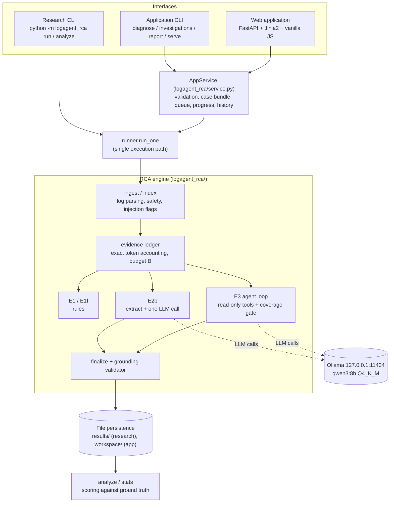

# MTech_project: LogAgent-RCA

AgentRCA: finding the actual root cause of an issue in a distributed system using AIOps and a local LLM.

This repository holds the M.Tech dissertation project **"Agentic AI Framework for Real-Time Root Cause Diagnosis and
Recommendations Generation in Ericsson pENM Deployments"**. The system is called **LogAgent-RCA**. It is a local,
read-only, log-based root-cause-analysis (RCA) assistant that runs on a local Ollama model (`qwen3:8b`).

All logs in this repository are **synthetic** and vendor-independent: they come from the project's own generator.
No Ericsson, customer or production data is included.

## 1. Research problem and objectives

**Research question.** Does iterative evidence collection improve log-based RCA over a strong single-pass LLM when
both get the same evidence-token budget?

Objectives:

1. Build LogAgent-RCA with safe log ingestion, exact evidence-token accounting, a rule-based baseline, a strong
   single-pass LLM baseline, an iterative agent with read-only tools, a coverage gate and a grounding validator.
2. Compare the agent with the single-pass baseline under an equal unique-evidence-token budget
   (B = 900 tokens), on a frozen synthetic test split, using a pre-registered analysis.
3. Report correctness, evidence grounding and cost honestly. The design is exploratory, so a null result is
   accepted as a valid outcome.

Diagnosis strategies (arms):

| Arm | Description |
|---|---|
| E1 | Rule-based RCA (detection and propagation rules written on the dev split only) |
| E1f | Log-free floor baseline |
| E2b | Strong single pass: deterministic evidence selection within budget B, then one LLM call |
| E3 | Iterative agent: read-only log tools within budget B, coverage gate, grounding validator |
| A2 | Ablation: E3 without the coverage gate |
| A3 | Ablation: E3's raw output before the validator (computed from E3 records, no extra runs) |

Design documents: `docs/research-design.md`, `docs/decisions.md`, `docs/literature-review.md`,
`docs/preregistration.md`. Dissertation chapter drafts are in `docs/dissertation/`.

## 2. Overall architecture



There is one RCA engine. The research runner, the application CLI and the web application all call the same
`runner.run_one` with the same model settings.

## 3. Research workflow

1. **Data.** `logagent_rca/synth/` generates synthetic multi-service incident cases with ground truth.
   * Dev split: 18 cases (`data/synthetic/dev`).
   * Test split: 60 cases in 20 fault families × 3 (`data/synthetic/test`), frozen at commit `a4a6c25`.
   * Each split has a `SHA256SUMS` file. The runner verifies it before every run.
2. **Calibration and pilot** on dev (`results/calibration`, `results/dev-pilot`, `results/dev-opcheck-b900`).
3. **Freeze.**
   * Rule R4 sets B = 900. The freeze also fixes temperature 0.2, 2 repeats for the LLM arms and 480 runs.
   * The freeze is commit `c5448ef`, tag `test-freeze`, config `configs/test.yaml`.
   * See `docs/preregistration.md`.
4. **Test run:** `python -m logagent_rca run --config configs/test.yaml`. It writes to `results/test-main/`.
5. **Analysis:**
   * Command: `python -m logagent_rca analyze --config configs/test.yaml`.
   * Unit of analysis: the case.
   * Statistics: cluster bootstrap and sign-flip permutation by family.

## 4. Web application architecture

* `logagent_rca/web/app.py` is the FastAPI adapter. It serves pages, the JSON API, security headers and a
  TrustedHost check.
* `logagent_rca/web/jobs.py` runs analyses on a single background worker, because Ollama runs one request at a time.
* `logagent_rca/web/auth.py` provides two auth modes:
  * Local mode: loopback only, no login, requires an anti-CSRF header.
  * Users mode: PBKDF2 password hashes, viewer/analyst/admin roles, signed session cookies and a CSRF token.
* `logagent_rca/web/templates/` and `static/` hold the pages: dashboard, new analysis, investigation (progress,
  report, evidence tracing, downloads), history, and settings & health.
* `logagent_rca/service.py`, `store.py` and `report_render.py` are shared with the CLI.
* Persistence is file-based, under `workspace/` (git-ignored). There is no database.
* `configs/app.yaml` uses the same model, budget, agent, validator, safety and ingestion settings as
  `configs/test.yaml`. A test enforces this.

Details: `docs/web/00-architecture-assessment.md`, `docs/web/README.md`, `docs/web/10-final-review.md`.

## 5. Installation

Requirements:

* Linux and Python 3.12.
* Ollama with `qwen3:8b` (tested with Ollama 0.40.16, Q4_K_M).
* About 16 GB RAM or more. The pilot measured high prompt-cache memory, so a 16 GB laptop is **not** claimed to be
  sufficient.

```bash
git clone https://github.com/govindjami5254-spec/MTech_project.git
cd MTech_project
python3.12 -m venv .venv
.venv/bin/python -m pip install -r requirements-logagent.txt -r requirements-web.txt

# Verified tokenizer (not stored in git; pinned revision and checksum)
mkdir -p models
curl -L -o models/qwen3-tokenizer.json \
  https://huggingface.co/Qwen/Qwen3-8B/resolve/b968826d9c46dd6066d109eabc6255188de91218/tokenizer.json
sha256sum models/qwen3-tokenizer.json
# expected: aeb13307a71acd8fe81861d94ad54ab689df773318809eed3cbe794b4492dae4

# Model server
ollama pull qwen3:8b
OLLAMA_HOST=127.0.0.1:11434 ollama serve &
```

## 6. Configuration

| File | Purpose |
|---|---|
| `configs/dev.yaml` | Dev split: calibration and pilot |
| `configs/test.yaml` | Frozen test configuration (do not edit; its hash is recorded in every run record) |
| `configs/app.yaml` | CLI `diagnose` and web UI: same model settings as `test.yaml`, data in `workspace/` |
| `config.yaml`, `rules.yaml`, `requirements.txt` | Legacy AgentRCA proof-of-concept prototype (`agentrca/`) |

Research runs accept `--set KEY=VALUE` overrides for exploratory use. Overridden runs are not frozen test runs.

## 7. Starting the web application

```bash
./scripts/start_web.sh          # = .venv/bin/python -m logagent_rca serve --config configs/app.yaml --host 127.0.0.1 --port 8765
```

* Open http://127.0.0.1:8765/ on the same machine.
* From another machine, tunnel instead of exposing the port: `ssh -L 8765:127.0.0.1:8765 <user>@<server>`.
* The server refuses to bind to a non-loopback address unless `--auth-file` is given.

## 8. Running an RCA investigation

**CLI** (same engine and persistence as the web UI):

```bash
.venv/bin/python -m logagent_rca diagnose \
  --log /path/api-gateway.log --log /path/db-primary.log \
  --incident-id INC-001 --description "Entry service returned 5xx errors" \
  --time 2026-01-10T10:05:05Z --trigger-file api-gateway.log --trigger-line 42 \
  --trigger-component api-gateway --mode E3            # or --mode E2b

.venv/bin/python -m logagent_rca investigations [--incident-id INC-001] [--mode E3]
.venv/bin/python -m logagent_rca report --investigation <inv-id> [--format md|json]
```

* **Log format:** `<timestamp> <LEVEL> <component> <message>`.
* **Trigger:** the 1-based line that reported the incident. It must lie between 600 s before and 120 s after the
  incident time.
* **Example input:** a synthetic dev case, such as `data/synthetic/dev/cases/dev-c004/` (see its `incident.json`).

**Web:** open *New analysis*, upload the logs, fill in the incident and trigger fields, choose E2b or E3, and click
Analyze. Analyses are refused while a research experiment is running on the same host.

**Research experiment:**

```bash
.venv/bin/python -m logagent_rca run --config configs/test.yaml       # resumable
.venv/bin/python -m logagent_rca analyze --config configs/test.yaml
```

## 9. Dataset and experiment information

* `data/synthetic/{dev,test}/cases/<case>/`: one `.log` file per service, plus `incident.json`.
* `data/synthetic/{dev,test}/truth/`: ground truth. Only the scorer reads it.
* `data/demo`, `data/eval_run1`, `runs/`: synthetic data and outputs of the legacy prototype.
* `archive/`: early prototype scratch outputs, the Ollama smoke test and the Ollama server log, preserved from
  outside the project folders (see `archive/README.md`).
* `results/`:
  * Calibration, smoke, integration, memory-check, dev pilot and operational-check outputs.
  * `results/test-main/` holds the partial test run (see below).
* Each run record stores the code commit, the config hash, the model and weights digests, the evidence ledger,
  metrics, the raw and validated reports, and the audit log and transcript.

## 10. Current implementation status

| Component | Status |
|---|---|
| Research engine (E1, E1f, E2b, E3, A2, A3), synthetic generator, runner, scorer, statistics | Complete; 166 tests |
| Dev pilot (90 runs) and operational check (30 runs) | Complete |
| Frozen test experiment (480 runs) | **INTERRUPTED and INCOMPLETE: 147 / 480 runs.** See `results/test-main/INTERRUPTED.md`. Partial records are **not** final results. |
| Web application and application CLI (stages M0–M10) | Implemented; 65 tests with a scripted LLM (231 tests in total pass) |
| Real-inference end-to-end check of the web UI / `diagnose` | **Not done** |
| Dissertation chapters 1–4 | Drafts in `docs/dissertation/` |
| Results chapters 5–7 | Not written (they depend on the completed test run) |

### Current stage, its purpose and remaining work (as of 2026-11-26)

**Current stage: the frozen test experiment, the confirmatory run on the test split. It is paused at 147 / 480 runs.**

Purpose of this stage:

* It produces the evidence that answers the research question.
* The iterative agent (E3) and the strong single-pass baseline (E2b) run on 60 unseen synthetic test cases (20 fault
  families). Both get the same evidence budget (B = 900 tokens), and all settings are frozen (`test-freeze`).
* The E1/E1f baselines and the A2/A3 ablations run alongside.
* Each LLM arm runs twice (repeats r0 and r1), so run-to-run variation can be measured.
* Because everything was fixed before any test case was seen (`docs/preregistration.md`), the results cannot be
  tuned after the fact.

Completed stages:

1. Research design and literature review.
2. Implementation stages M1–M11 (engine, synthetic data, baselines, agent, gate, validator, runner, statistics,
   measurement fixes).
3. Dev pilot (90 runs) and operational check (30 runs).
4. Budget selection (B = 900) and the freeze.
5. Dissertation drafts for chapters 1–4.
6. Web application and CLI stages M0–M10.

Remaining work:

| # | Task | Notes |
|---|---|---|
| 1 | Resume the test experiment with the `test-freeze` code | 333 runs remain: r0 for cases c030 (E2b/E3/A2) and c031–c060, then r1 for E2b/E3/A2 on all 60 cases. At the measured speed (about 28.5 min per case per repeat) this takes **about 43 hours** of CPU time. |
| 2 | Record the interruption and resume as a deviation | Required by the pre-registration |
| 3 | Score and analyse: `python -m logagent_rca analyze --config configs/test.yaml` | H1 (E3 − E2b correctness, family-clustered CI), H2 (grounding), H3 (cost); A2/A3 ablations |
| 4 | Write dissertation chapters 5 (results), 6 (discussion) and 7 (conclusion); revise chapters 1–4, abstract and references | Depends on 3 |
| 5 | Resolve the open supervisor questions (Q-001, Q-002, Q-006), the manual literature searches (Q-014) and the IEEE full texts (Q-015) | See `docs/decisions.md` |
| 6 | Web app: diagnose and fix the "Analyze does nothing" defect, simplify the New-analysis form, add regression tests | Diagnosis started; the root cause is not yet confirmed; changes need approval |
| 7 | Web app: real end-to-end check with Ollama on a known synthetic case | Only when no experiment is running |
| 8 | Submit the dissertation | Deadline **2 December 2026** |

## 11. Known limitations

* **Open web defect.** The user reported that clicking **Analyze** on the New analysis page appears to do nothing.
  * No investigation was stored by that server, so the failure happens before the upload is accepted.
  * The root cause has **not yet been identified**.
  * The form also asks for too much manual input: incident ID, rule ID, incident time and time zone, trigger
    file/line/component. Simplifying it is planned, not implemented.
* The web JavaScript has only been checked statically. No browser-based test exists.
* No automated test uses real model inference. All application tests use a scripted LLM.
* There is one worker and one server process, and analyses are serialised. On CPU, an analysis takes several
  minutes (dev: about 8 min for E2b, about 12 min for E3).
* Only one log line format is supported, and the trigger line must be named. Incidents are not detected
  automatically.
* Sessions reset when the server restarts. There is no delete or retention endpoint and no container image.
* The web app is not hardened for exposure beyond localhost (no TLS or rate limiting).
* Confidence values are model self-assessments, and recommendations are not evaluated.
* The results come from synthetic data only. No real-time (seconds), production-readiness or superiority claims
  are made.

## 12. How the research code and the web application relate

* Branches:
  * The research work was developed on branch `logagent-rca` and frozen at tag `test-freeze` (`c5448ef`).
  * The web application and application CLI were developed on `feature/logagent-rca-web`, which branches from
    `test-freeze`.
* The web branch only **adds** code. Among existing files, it changes only `logagent_rca/__main__.py` (new
  subcommands; `run` and `analyze` are unchanged) and `.gitignore`.
* `main` contains everything: research code, data and results; the web app and CLI; documentation; dissertation
  drafts; and the partial test results.
* Other preserved branches:
  * `poc-preservation`: the original AgentRCA prototype.
  * `research-design`: the design documents.
* Tags:
  * `pilot-dev-start` (`b21644c`).
  * `test-freeze` (`c5448ef`): the code that produced `results/test-main`.
* The web application is a user-facing interface to the same engine. It is **not** part of the dissertation's
  experimental evidence.
